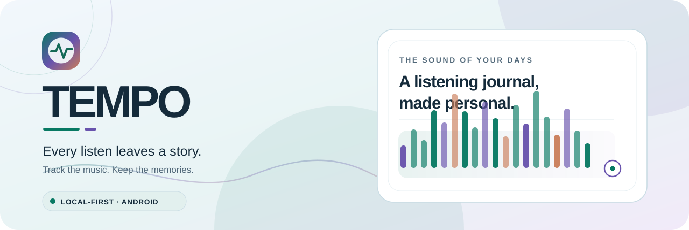

<!-- Tempo • community-maintained Android listening journal -->
<p align="center">
  <picture>
    <source media="(prefers-color-scheme: dark)" srcset="assets/readme/tempo-hero-dark.svg">
    
  </picture>
</p>

<p align="center">
  <a href="https://github.com/matchalattewithbanana/Tempo/releases/latest"></a>
  <a href="https://github.com/matchalattewithbanana/Tempo/releases"></a>
  <a href="https://github.com/matchalattewithbanana/Tempo/stargazers"></a>
</p>

<p align="center">
  <strong>A local-first listening journal for Android.</strong><br>
  Keep track of the music you play, understand your habits, bring past listens together, and make the experience unmistakably yours.
</p>

<p align="center">
  <picture>
    <source media="(prefers-color-scheme: dark)" srcset="assets/readme/chips-dark.svg">
    
  </picture>
</p>

<p align="center">
  <a href="https://github.com/matchalattewithbanana/Tempo/releases/latest"><strong>Get the Android APK</strong></a>
  &nbsp;·&nbsp;
  <a href="browser-extension/README.md#install-from-github">Browser companion</a>
  &nbsp;·&nbsp;
  <a href="docs/README.md">Documentation</a>
  &nbsp;·&nbsp;
  <a href="https://github.com/matchalattewithbanana/Tempo/issues">Report an issue</a>
</p>

<p align="center"><sub>Community-maintained fork of <a href="https://github.com/avinaxhroy/Tempo">the original Tempo</a>. Published downloads are independent of the upstream Google Play app.</sub></p>

<p align="center">
  <picture>
    <source media="(prefers-color-scheme: dark)" srcset="assets/readme/divider-dark.svg">
    
  </picture>
</p>

## Overview

Tempo is a music-listening tracker, not a streaming player. It builds a personal history from supported playback information, brings in compatible exports, and turns those records into meaningful listening stats, artwork-led summaries and milestones.

The idea is simple: **your listening history should be useful, personal, and enjoyable to explore.**

- **Track:** supported Android player activity, with optional Spotify signals.
- **Understand:** songs, albums, artists, listening durations, trends, challenges and badges.
- **Bring it together:** supported music-history imports and optional browser sync.
- **Make it yours:** curated appearance presets, layouts, share cards, widgets and launcher icon options.

> **Release vs. source:** The latest published release is **[v4.9.9](https://github.com/matchalattewithbanana/Tempo/releases/tag/v4.9.9)**. The Material 3 Expressive redesign, latest icon options and other commits on `main` are **unreleased until a newer APK is built and published**. Do not assume the current download already contains them.

<p align="center">
  <picture>
    <source media="(prefers-color-scheme: dark)" srcset="assets/readme/divider-dark.svg">
    
  </picture>
</p>

## What makes Tempo different?

**Listening is more than a play count.** Tempo brings listening records, music artwork, trends and a personalized visual experience into one Android app. Its local-first library helps keep that experience usable without requiring you to publish your music history to a social service.

It also treats playback evidence carefully. **Now Playing is provisional**, different apps expose different timing signals, and imports can have incomplete timestamps or durations. Tempo does not claim that all sources report the same level of accuracy; the [tracking and import accuracy guide](docs/TRACKING_AND_IMPORT_ACCURACY.md) explains the differences.

<p align="center">
  <picture>
    <source media="(prefers-color-scheme: dark)" srcset="assets/readme/divider-dark.svg">
    
  </picture>
</p>

## Feature atlas

<table>
  <tr>
    <td width="50%" valign="top">
      <br>
      <strong>Live listening</strong><br>
      Tempo listens to supported Android playback signals, with optional Spotify device broadcasts and reconciliation. Now Playing is immediate feedback; completed listening records depend on the available timing evidence.<br><br>
      <code>MediaSession</code> <code>Device broadcasts</code> <code>Playback signals</code>
    </td>
    <td width="50%" valign="top">
      <br>
      <strong>Your listening, in context</strong><br>
      Explore recent plays, top tracks, artists and albums, listening trends, rankings, challenges and badges. Turn listening history into a journal worth revisiting.<br><br>
      <code>History</code> <code>Statistics</code> <code>Milestones</code>
    </td>
  </tr>
  <tr>
    <td width="50%" valign="top">
      <br>
      <strong>Bring your history with you</strong><br>
      Import supported history from Spotify, Apple Music, Last.fm, YouTube Music, Deezer and Musicolet. Matching and deduplication aim to reduce overlapping records.<br><br>
      <code>Spotify + Apple</code> <code>Last.fm</code> <code>Import matching</code>
    </td>
    <td width="50%" valign="top">
      <br>
      <strong>Appearance Studio</strong><br>
      Explore 18 curated looks, Light/Dark/OLED tones, font and shape options, reusable saved looks, configurable layouts, and rich Material 3 Expressive styling on the development branch.<br><br>
      <code>18 palettes</code> <code>Material You</code> <code>Custom layouts</code>
    </td>
  </tr>
  <tr>
    <td width="50%" valign="top">
      <br>
      <strong>Make it shareable</strong><br>
      Create Spotlight stories, listening-summary cards and a customizable 3×3 album poster. Share music memories without needing to publish your entire library.<br><br>
      <code>Spotlight</code> <code>Share cards</code> <code>Album poster</code>
    </td>
    <td width="50%" valign="top">
      <br>
      <strong>Keep your records yours</strong><br>
      Export and restore your library locally, or configure optional Google Drive backup. Review the privacy and backup limitations before moving between installations.<br><br>
      <code>Local export</code> <code>Restore</code> <code>Optional Drive</code>
    </td>
  </tr>
  <tr>
    <td width="50%" valign="top">
      <br>
      <strong>Listening beyond Android</strong><br>
      The Chromium/Firefox companion records supported browser-player activity and pairs with the Android app. Both companion packages ship alongside the published Android APK.<br><br>
      <code>Chromium</code> <code>Firefox</code> <code>Paired sync</code>
    </td>
    <td width="50%" valign="top">
      <br>
      <strong>A deliberate Update Center</strong><br>
      The in-app Update Center supports Stable and opt-in Preview channels, release notes, verified APK downloads, and Android's normal install confirmation. Automatic checks are optional; installs are not silent.<br><br>
      <code>Release notes</code> <code>APK verification</code> <code>User approval</code>
    </td>
  </tr>
</table>

<details>
<summary><strong>More details about playback accuracy, cloud sync and release safety</strong></summary>

**Playback tracking:** notification/MediaSession signals and compatible device broadcasts may report different information. Spotify API reconciliation uses a requested background cadence of about 20 minutes, which Android may defer. See [tracking and import accuracy](docs/TRACKING_AND_IMPORT_ACCURACY.md).

**Backups:** local records use app-private Room/SQLite. Backup archives are not independently password-encrypted. Optional cloud features and third-party metadata services have their own network and data flows. Read [privacy](PRIVACY.md) and [Drive configuration](docs/GOOGLE_DRIVE_SETUP.md).

**Updates:** automatic checks are off by default. The Update Center only downloads an APK after a user request, verifies the asset and package/signing information, and defers installation to Android. Signing-key changes can prevent in-place upgrades; export a backup first. See [releases](docs/releases/README.md).

</details>

<p align="center">
  <picture>
    <source media="(prefers-color-scheme: dark)" srcset="assets/readme/divider-dark.svg">
    
  </picture>
</p>

## Screenshots

<table>
  <tr>
    <td width="25%" align="center" valign="top"></td>
    <td width="25%" align="center" valign="top"></td>
    <td width="25%" align="center" valign="top"></td>
    <td width="25%" align="center" valign="top"></td>
  </tr>
  <tr>
    <td width="25%" align="center" valign="top"></td>
    <td width="25%" align="center" valign="top"></td>
    <td width="25%" align="center" valign="top"></td>
    <td width="25%" align="center" valign="top"></td>
  </tr>
</table>

<sub>These are historical repository screenshots, **not screenshots of the unreleased Material 3 Expressive redesign**. Updated device captures will be needed when that version has been compiled and tested.</sub>

<p align="center">
  <picture>
    <source media="(prefers-color-scheme: dark)" srcset="assets/readme/divider-dark.svg">
    
  </picture>
</p>

## Download & installation

<p align="center">
  <a href="https://github.com/matchalattewithbanana/Tempo/releases/latest"></a>
  <a href="browser-extension/README.md#install-from-github"></a>
</p>

Tempo supports **Android 8.0 (API 26) and newer**. For the latest published binaries, use the [GitHub releases page](https://github.com/matchalattewithbanana/Tempo/releases/latest). Release **v4.9.9** includes the Android APK, Chromium and Firefox companion archives, and `SHA256SUMS.txt`.

1. Download the APK and its release checksum file.
2. Verify the download against `SHA256SUMS.txt` and install it using Android's installer.
3. Grant only the permissions needed for your chosen tracking sources and finish setup in the app.

**Upgrading?** Back up your data first. An Android update can be installed over an existing copy only when package identity and signing certificate are compatible. GitHub APKs are separate from upstream Play Store distribution. Consult the [release catalog](docs/releases/README.md) for version history, checksums and known limitations.

<p align="center">
  <picture>
    <source media="(prefers-color-scheme: dark)" srcset="assets/readme/divider-dark.svg">
    
  </picture>
</p>

## The expressive side of Tempo

Tempo's ongoing Material 3 Expressive work extends the visual system through native Compose motion, responsive navigation, tonal bento layouts, expressive buttons and shape families, and accessible loading states. **Appearance Studio** offers 18 curated color presets with Light, Dark, OLED and System-tone previews, alongside typography, density, corner and motion preferences.

On the source branch, selectable launcher artwork includes **Tempo Classic**, **Pulse Mint**, **Tempo Clock**, **Violet Trail** and **Vinyl Night**. The browser companion, Android widgets, stats and sharing have their own documentation and release notes.

Explore the [Material 3 Expressive migration](docs/MATERIAL3_EXPRESSIVE.md), [visual design reference](docs/EXPRESSIVE_DESIGN_REFERENCE.md) and [changelog](Changelog.md). These describe source changes; compilation, visual accessibility checks and physical-device performance verification are still pending for the latest unreleased work.

<p align="center">
  <picture>
    <source media="(prefers-color-scheme: dark)" srcset="assets/readme/divider-dark.svg">
    
  </picture>
</p>

## How the project is structured

This is the Android client and its optional browser companion. Playback tracking, local storage, importers and UI are kept in the same repository; documentation explains their boundaries.

| Area | Purpose |
| --- | --- |
| [`app/src/main/java/me/avinas/tempo/`](app/src/main/java/me/avinas/tempo) | Android app: playback/tracking, data, services, Compose screens and settings |
| [`app/src/main/res/`](app/src/main/res) | Android resources, including Material artwork and launcher icons |
| [`browser-extension/`](browser-extension) | Chromium and Firefox listening companion |
| [`docs/`](docs/README.md) | Architecture, accuracy, reliability, privacy, releases and engineering notes |
| [`Screenshots/`](Screenshots) | Historical UI captures for reference |

For a deeper tour, see [architecture](docs/ARCHITECTURE.md) and [development setup](docs/DEVELOPMENT.md).

<p align="center">
  <picture>
    <source media="(prefers-color-scheme: dark)" srcset="assets/readme/divider-dark.svg">
    
  </picture>
</p>

## Build from source

You will need **JDK 21**, **Android SDK 37.1** for the current `main` branch, and the checked-in Gradle wrapper. The application targets Android SDK 36 and supports API 26+. Optional service integrations require their own setup.

```bash
git clone https://github.com/matchalattewithbanana/Tempo.git
cd Tempo
./gradlew :app:testDebugUnitTest
./gradlew :app:assembleDebug
```

For the optional browser companion, use **Node.js 20** and its checked-in lockfile:

```bash
cd browser-extension
npm ci
npm run typecheck
npm run build:all
```

Builds and release workflows are **manual**, not triggered by normal commits. Local builds and GitHub releases may use different signing certificates. Read [development](docs/DEVELOPMENT.md), [release policy](docs/BUILD_AND_RELEASE_POLICY.md) and [contribution guidelines](CONTRIBUTING.md) before changing packaging or release workflows.

<p align="center">
  <picture>
    <source media="(prefers-color-scheme: dark)" srcset="assets/readme/divider-dark.svg">
    
  </picture>
</p>

## Privacy, support & documentation

Tempo keeps its primary listening library in app-private local storage. Optional integrations, metadata lookup, sharing, health reporting and backups have their own privacy considerations; **local-first does not mean that every optional feature is offline**.

| Resource | Read this for |
| --- | --- |
| [Privacy policy](PRIVACY.md) · [Browser privacy](browser-extension/PRIVACY.md) | Stored data, optional network flows, retention and user controls |
| [Tracking accuracy](docs/TRACKING_AND_IMPORT_ACCURACY.md) | Timing evidence, import matching and reconciliation |
| [Docs index](docs/README.md) | Feature guides, audits and development reference |
| [Support](SUPPORT.md) · [Issues](https://github.com/matchalattewithbanana/Tempo/issues) | Troubleshooting, reproducible bug reports and feature suggestions |
| [Security](SECURITY.md) | Responsible vulnerability disclosure |
| [Changelog](Changelog.md) · [Release catalog](docs/releases/README.md) | Published releases versus unreleased work |

<p align="center">
  <picture>
    <source media="(prefers-color-scheme: dark)" srcset="assets/readme/divider-dark.svg">
    
  </picture>
</p>

## Credits & license

Tempo was originally created by **[Avinash (avinaxhroy)](https://github.com/avinaxhroy/Tempo)**. This maintained fork is developed by **[matchalattewithbanana](https://github.com/matchalattewithbanana)**, with original project attribution and notices preserved.

**License:** The repository retains the original [Tempo Custom License](LICENSE), based on AGPLv3 **with additional restrictions**, including non-commercial use and no rebranding/white-label distribution. It is **not** an unrestricted standard AGPL license. See [NOTICE.md](NOTICE.md) for full attribution and service trademark information.

<p align="center">
  <sub>Made for people who care about the music between the moments.</sub>
</p>
